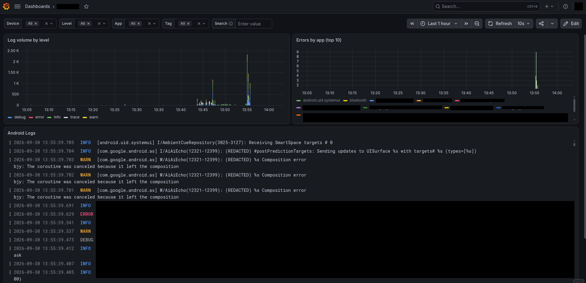
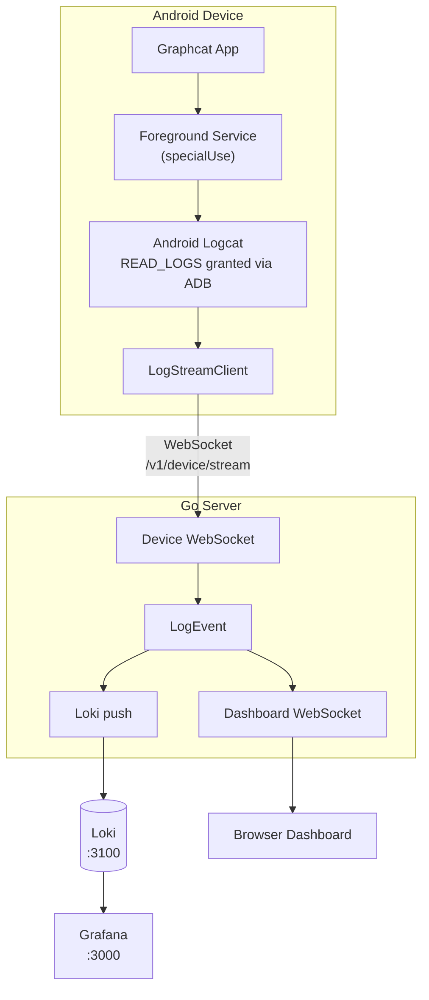

# Graphcat

Stream an Android device's `logcat` output in real time over WebSockets to a Go server, which stores it in Loki for searching in Grafana.



## How it works

- **Android app** (`Android/`) — tails `logcat` in a foreground service and pushes each log line to a server as JSON over a WebSocket.
- **Server** (`Go/server/`) — a Go WebSocket hub that receives log events from device(s), broadcasts them to connected dashboards, and pushes them to Loki for persistent storage. Also serves `index.html`, a minimal raw view for checking that events are arriving.
- **Test client** (`Go/testclient/`) — a standalone Go program that simulates a device by sending one fake log event per second, useful for testing the server/dashboard without a real phone.
- **Loki** (`infrastructure/loki/`) — a local Loki instance (via Docker Compose) that the server pushes every `LogEvent` to, for historical/searchable log storage alongside the live dashboard.
- **Grafana** (`infrastructure/grafana/`) — a local Grafana instance (via Docker Compose) for querying and searching the logs stored in Loki.

```
Android device --(WebSocket: /v1/device/stream)--> Go server --(WebSocket: /v1/dashboard/stream)--> Browser dashboard
```

## Requirements

- Docker with Docker Compose (Loki and Grafana)
- Go 1.27+ (server and test client)
- Android SDK 35 and a full JDK 25+ — not a JRE, Gradle needs `jlink` (minSdk 26)
- `adb` and a phone with USB debugging enabled, for the one-time install and permission grant
- The phone must reach the server's port `8080`: same LAN, or both on the same Tailscale tailnet. The app uses plain `ws://` (`usesCleartextTraffic`), so only do this on a network you trust.

## Quick start

Start things in this order — each step depends on the one before it:

1. **Loki** — `cd infrastructure/loki && docker compose up -d`
2. **Grafana** — `cd infrastructure/grafana && docker compose up -d`
3. **Server** — `cd Go/server && go run .` (leave it running)
4. **Android app** — first time only: build, install and grant `READ_LOGS` as in [Running the Android app](#running-the-android-app). Then open Graphcat, tap **Change Server** if needed, and press **Start Streaming**.
5. **Check it** — `http://localhost:8080` shows raw events arriving; Grafana at `http://localhost:3000` → Dashboards → Graphcat → **Graphcat** for search and filtering.

No phone? Replace step 4 with the [test client](#trying-it-without-a-phone).

To shut down: press **Stop Streaming**, stop the server with Ctrl+C, then `docker compose down` in `infrastructure/grafana` and then `infrastructure/loki`. Logs stay in `infrastructure/loki/data`.

The sections below explain each step in detail.

## Running Loki

```
cd infrastructure/loki
docker compose up -d
```

This starts Loki on `:3100` using `loki-config.yaml` (filesystem storage under `infrastructure/loki/data`). It also creates the `graphcat` Docker network that Grafana joins, so start Loki first.

## Running Grafana

```
cd infrastructure/grafana
docker compose up -d
```

This starts Grafana on `:3000` (data under `infrastructure/grafana/data`) on the external `graphcat` network, so Loki must already be running. Open `http://localhost:3000` and log in with Grafana's default `admin` / `admin` (it asks you to choose a new password on first login). Everything it needs is provisioned from files on startup:

- `provisioning/datasources/loki.yaml` — the Loki data source (`http://graphcat-loki:3100`)
- `provisioning/dashboards/graphcat.yaml` + `dashboards/graphcat.json` — the **Graphcat** dashboard (in the Graphcat folder): filters for device, level, app and tag, a free-text search box, log volume by level, top errors by app, and the log list
- `provisioning/alerting/graphcat.yaml` — an "Error spike per app" alert rule (>50 errors in 5 min). No contact point is configured, so it only shows up in Grafana's Alerting page.

Provisioned items are read-only in the Grafana UI; to change them, edit the files and restart Grafana (`docker compose restart`). To tweak the dashboard visually, edit it in Grafana, then use **Export → JSON** and save it over `dashboards/graphcat.json`.

## Running the server

```
cd Go/server
go run .
```

Run it from `Go/server` — it serves `index.html` from the current directory. It pushes every received `LogEvent` to Loki at the `LOKI_URL` env var (defaults to `http://localhost:3100`). A push failure is logged and the event is still broadcast to the live dashboard, but pushes are currently synchronous, so a slow or unreachable Loki delays everything (see [Known issues](TODO.md#known-issues)) — start Loki first.

The server listens on `:8080` on all interfaces, including Tailscale's:
- `POST/GET /v1/device/stream` — devices connect here and push log events
- `GET /v1/dashboard/stream` — browsers connect here to receive broadcasts
- `GET /` — serves the dashboard (`index.html`)
- `GET /healthz` — health check

Open `http://localhost:8080` in a browser for a raw live view of incoming events — a quick check that the pipeline works. For searching and filtering, use Grafana.

If the phone can't connect, check that a firewall on the server machine allows incoming TCP `8080` (on the LAN interface, or on `tailscale0` for Tailscale). From the phone's browser, `http://<server-ip>:8080/healthz` should return `ok`.

## Trying it without a phone

With the server running:

```
cd Go/testclient
go run .
```

This connects to `ws://localhost:8080/v1/device/stream` and streams synthetic log events once per second, which will appear on the dashboard and in Grafana.

## Running the Android app

One-time setup:

1. Copy the local properties template and fill in your values:
   ```
   cd Android
   cp local.properties.example local.properties
   ```
2. Edit `local.properties`:
   - `sdk.dir` — path to your Android SDK
   - `SERVER_URL` — the default server, e.g. `ws://192.168.1.100:8080/v1/device/stream`. Optional: you can also set the server in the app (see below).
3. Connect the phone with USB debugging enabled, then build and install:
   ```
   ./gradlew installDebug
   ```
4. Grant `READ_LOGS` (without it the app only sees its own logs; no root needed):
   ```
   adb shell pm grant com.example.graphcat android.permission.READ_LOGS
   ```
5. Restart the app so the permission takes effect:
   ```
   adb shell am force-stop com.example.graphcat
   adb shell am start -n com.example.graphcat/.MainActivity
   ```

After that the phone doesn't need to be connected to the computer. To stream:

1. Make sure the server is running.
2. Open Graphcat. The **Server** line shows where it will connect.
3. To change it, tap **Change Server** and enter the server machine's IP or hostname — just the address, e.g. `192.168.1.100`; port `8080` and the path are added for you (add `:port` for a different port). For Tailscale, use the server's Tailscale IP (`100.x.y.z`) or MagicDNS name (e.g. `my-pc.tail1234.ts.net`), with Tailscale running on both the phone and the server. The setting is saved on the phone and overrides `SERVER_URL`.
4. Press **Start Streaming**. The status should go to **Streaming**. **Change Server** is disabled while streaming; stop first to change it.

If the status shows **Connection failed**, see the firewall note under [Running the server](#running-the-server). It doesn't retry by itself yet, so press **Start Streaming** again once the server is reachable.

## Planned architecture

The server fans each event both to connected dashboards and to Loki as a persistent, searchable log store, with Grafana on top of Loki for historical search:



- **Android** — the collector. `LogStreamService` (a foreground `specialUse` service) keeps `logcat -v long` running after the app is backgrounded, using system-wide `READ_LOGS` granted via `adb shell pm grant`. Each entry's UID is resolved to a package name by `AppResolver` (installed apps via `QUERY_ALL_PACKAGES`, plus platform and isolated UIDs). Parsed entries become structured `LogEvent` JSON (`device_id`, `seq`, `timestamp`, `priority`, `tag`, `pid`, `tid`, `uid`, `package`, `message`) and are sent over `/v1/device/stream` — raw logcat text never leaves the device.
- **Go server** — the ingestion/control layer. Each `LogEvent` received from a device does two things: it's pushed to Loki (`LokiClient.Push` in `Go/server/loki.go`, at the `LOKI_URL` env var, defaulting to `http://localhost:3100`) for historical search, and it's broadcast live to any connected dashboard over `/v1/dashboard/stream`. A Loki push failure is only logged, so the live dashboard keeps receiving events without Loki/Grafana; however, pushes are synchronous and one request per event, so a slow or down Loki currently throttles ingestion (see [Known issues](TODO.md#known-issues)).
- **Loki** — the log storage/search backend, runs locally via Docker Compose (`infrastructure/loki/`, `:3100`). Each event is stored with the labels `job="graphcat"`, `device_id`, `priority`, `level` (Android priority mapped to Grafana's level names: V→trace, D→debug, I→info, W→warn, E→error, F→critical), `tag`, and `app` (package name, or `unknown`), e.g. `{device_id="android-01", level="error", app="com.android.systemui"}`. The log line mirrors `adb logcat`: `[app] P/Tag(pid-tid): message`.
- **Grafana** — the operator/search UI (`infrastructure/grafana/`, `:3000`), the main UI: live tailing, search, filtering, time ranges, and dashboards across one or many devices, with the data source, dashboard and alert rule provisioned from files (see [Running Grafana](#running-grafana)).
- **Two views**: Grafana (`Go → Loki → Grafana`) is the main UI for tailing, searching and investigating; `index.html` (`Go → Browser`) is just a rough raw view to confirm events are flowing, independent of Loki/Grafana.
- **Multiple devices** — the server and Loki labels are designed for this, but the Android app currently hardcodes `device_id = "android-01"`, so this doesn't work yet (see [Known issues](TODO.md#known-issues)). Once fixed, Android devices connect to the same `/v1/device/stream` endpoint with distinct `device_id`s, and Loki labels make it possible to query a single device or across all of them.

See [TODO.md](TODO.md) for remaining work and [known issues](TODO.md#known-issues).
